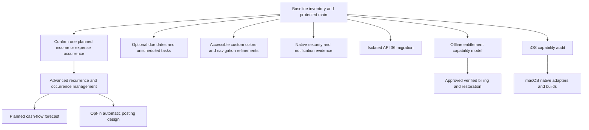

# LifeOS master delivery plan

Prepared 2026-11-17 from the repository implementation and the owner's Master Development Program. Baseline integration is PRs [#39](https://github.com/PavanKotana18/lifeOS/pull/39), [#40](https://github.com/PavanKotana18/lifeOS/pull/40), and [#41](https://github.com/PavanKotana18/lifeOS/pull/41), previously verified on main at `315b56de85989707f271fe6ae7452cd3ad7acbf5`. The delivery coordinator must refresh the exact remote SHA and CI evidence for every subsequent milestone.

This is a source-backed inventory, not a claim that every implemented feature has passed native acceptance. IMPLEMENTED means a production path exists; PARTIAL means a useful path exists with specified gaps; MISSING means no production implementation was found; BLOCKED means execution requires an unavailable prerequisite; DEFERRED means deliberately queued behind a stated dependency or consent boundary. Historical documentation does not override these restrictions: the owner's physical phone is permanently excluded, production user data must never be touched, local emulator guards must remain enabled, and Play publication or billing activation needs separate approval.

## Product inventory

### A. Money 2.0

| Capability | State at baseline | Evidence and remaining work |
|---|---|---|
| Income/expense create, edit, delete and rapid entry | IMPLEMENTED | `src/App.tsx` transaction form and `saveNewRecord`, `userPreferences.ts` validation, protected `StorageService`; optional description, category, date/time and payment method already exist. |
| Reliable Duplicate Transaction | IMPLEMENTED | `transactionDraft.ts` preserves exact stored amount/currency and compatible active optional account; `test_transaction_duplicate_20261107.cjs` covers encrypted save, locked-session denial and cash-flow results. No second duplicate-entry feature is needed. |
| Exact monetary identity and multi-currency rules | IMPLEMENTED | `financeCore.ts` minor units, currency metadata, explicit conversions; `financeAnalytics.ts` excludes unrelated currencies. Preserve legacy untagged currency semantics and current safe numeric compatibility limits. |
| Optional accounts, balances and transfers | IMPLEMENTED | `MoneyAccounts.tsx`, `financialAccounting.ts`, encrypted facade account repositories. Opening balances and transfers are not income; card liability signs and linked transfer reversals exist. |
| Optional account edit lifecycle | PARTIAL | Account-free entry works. Review `saveNewRecord`'s existing-account fallback before allowing assigned-to-unassigned edits; test clearing assignment without silently restoring it. |
| Recurring transaction indicator | PARTIAL | `Transaction.isRecurring` is a boolean marker, not a schedule or posting engine. Never infer cadence or backfill transactions from that flag. |
| Planned bills | IMPLEMENTED | `MoneyPlanning.tsx` and `PlannedCommitment`: weekly/monthly/yearly cadence, next due date, pause state, optional category/account; estimates remain outside posted expense totals. |
| Confirmation-first scheduled occurrence posting | MISSING at baseline; active implementation | First active milestone includes both planned income and expenses. Reuse planned commitments, existing transaction validation and encrypted coordinator; atomically create one transaction of the reviewed type and advance the schedule with durable retry identity. Missing type on historical plans remains expense. |
| Recurring income and recurrence management | PARTIAL in active implementation | The first slice adds explicit income/expense type and cadence anchoring. Advanced skip/resume, edit-history policy, catch-up and occurrence management remain queued; do not infer a new schedule from an old transaction's recurring flag. |
| Automatic posting | DEFERRED | Depends on idempotent explicit posting and clear opt-in/revocation. No implicit background writes, silent historical catch-up, or native scheduling dependency in the first slice. |
| Recorded cash-flow history, budgets and spending trends | IMPLEMENTED | `MoneyHome.tsx`, `financeAnalytics.ts`, `FinanceCharts.tsx`, budget display helpers. Preserve missing-month versus zero semantics and explain excluded currencies. |
| Savings goals, contributions and scenario tools | IMPLEMENTED | `FinanceSavingsSummary.tsx`, `SavingsGoalProgress.tsx`, `FinanceProjection.tsx`, `FinanceCurrencyConverter.tsx`; assumptions are scenarios, not promised returns. |
| Forecast combining future planned occurrences | PARTIAL | Savings scenarios exist; occurrence-based cash-flow forecasting is missing. Build a separate planned series, never add plans to posted history or imply a complete bank balance from incomplete records. |

### B. Tasks, habits and goals

| Capability | State at baseline | Evidence and remaining work |
|---|---|---|
| Tasks 2.0 details, subtasks and progress | IMPLEMENTED | `TaskDetailScreen.tsx`, `TaskSubtasks.tsx`, `taskViews.ts`, optional encrypted in-record `TaskSubtask[]`, task backup validation and `test_tasks_2_0.cjs`. Preserve these merged paths. |
| Today/Upcoming views and task routing | IMPLEMENTED | `PlanHub.tsx`, Today sections and Planner in `App.tsx`; local calendar grouping, selected-date navigation and detail return focus exist. Consistency remains a regression requirement. |
| Optional due dates and quick unscheduled tasks | MISSING | `Task.dueDate` and save/backup validators still require a date. Must update all date consumers and migration/import compatibility together, not merely remove HTML `required`. |
| Recurring task generation and reminder editing | PARTIAL | `domainUtils.ts`, encrypted task `toggleCompleted`, recurrence roots/spawned-task links and reminder form exist. Extend month-end/timezone/retry behavior only after reviewing current recurrence tests. |
| Habit tracking and analytics | IMPLEMENTED | Habit create/edit/logging, configured schedules, streak calculations and Life/Today integration exist; `test_habit_analytics_wiring.js` and recurrence/domain regressions apply. |
| Goals, milestones and progress | IMPLEMENTED | Goal/milestone repositories, forms, status calculations and `LifeHub.tsx` exist; `test_goal_status_ui.js` protects current behavior. Richer cross-domain workflows are incremental work. |

### C. Appearance and navigation

| Capability | State at baseline | Evidence and remaining work |
|---|---|---|
| Soft Ivory + Sage default and configurable theme catalog | IMPLEMENTED | `themeCatalog.ts` already defaults to `soft-ivory-sage` and contains six paired light/dark themes, contrast calculation and semantic CSS tokens. Do not rebuild the theme system. |
| Arbitrary user accent/color selection | MISSING | Catalog selection exists; no audited arbitrary-color generator was found. Derive foreground/focus/state tokens and enforce contrast across light/dark modes before exposing custom colors. |
| Customizable Today cards | IMPLEMENTED | `todayLayout.ts` normalizes section ordering and hidden cards; App settings persist layout. `test_today_layout_20261107.cjs` covers encrypted restart persistence. |
| Contextual full-screen details and forms | PARTIAL | Task details, retained screens, dialogs and shared form sheets exist. Review long Money/settings journeys individually; retain focus/Back/draft semantics when extracting screens. |
| Gesture navigation and motion | PARTIAL | `navigationGestures.ts`, `uiNavigation.ts`, retained screen states and CSS easing exist. A measured spring/velocity settling model is not complete; native smoothness cannot be inferred from source tests. |
| Reduced motion, responsive layout and accessible focus | PARTIAL | Reduced-motion CSS, dialog hooks, semantic controls and responsive regression contracts exist. Rendered keyboard, zoom, screen-reader and native Back acceptance still need targeted evidence. |

### D. Security, privacy and resilience

| Capability | State at baseline | Evidence and remaining work |
|---|---|---|
| Encrypted IndexedDB and protected storage admission | IMPLEMENTED | `encryptedStorageFacade.ts`, `encryptedDexieStore.ts`, `encryptedRecordCodec.ts`, `encryptedTransactionCoordinator.ts`, `db.ts` storage proxy. Reads/writes require admitted session; new features must use this boundary. |
| Contextual first-private-save setup and recovery deferral | IMPLEMENTED | `FirstRecordSecurityDialog.tsx`, `cryptoSessionCoordinator.ts`, `onboardingJourney.ts`, `test_secure_startup.js`, first-record regressions. Preserve explicit consent, deferred-recovery state and retry rules; never auto-provision native keys. |
| Android biometrics/device credentials | PARTIAL | `BiometricAuthPlugin.java` and `LifeOSCryptoPlugin.java` use platform authentication policies with API-dependent distinctions. Synthetic/source coverage is not proof of real enrollment, cancellation or credential behavior. |
| Optional app-specific PIN | MISSING | No production PIN verifier/key-wrapping design found. Requires isolated threat review, rate limiting, secure key policy and recovery design; never replace fail-closed native protection with a UI-only PIN. |
| Locking, lifecycle and private recent-app previews | PARTIAL | `sessionManager.ts`, lifecycle coordinator, `screenshotProtection.ts`, native capture plugin/MainActivity and acceptance tests exist. Expand process-death, native prompt, picker and resume evidence without logging private content. |
| Encrypted backup, import/restore and recovery validation | IMPLEMENTED | Backup crypto/export/import services, recovery export lifecycle, `db.ts` schema/reference validation and synthetic backup tests exist. Every new persisted finance field needs compatible validation and restore/retry tests. |
| End-to-end native security acceptance | BLOCKED | Interactive authentication and consent require a legitimate test environment and operator action. Do not use the prohibited phone or simulate consent as a passing native result. |

### E. Notifications

| Capability | State at baseline | Evidence and remaining work |
|---|---|---|
| Reminder schedule/cancel/reconcile and diagnostics | IMPLEMENTED | `notificationService.ts` owns IDs and separates task reminders, deadlines and overdue alerts. Pending observation, receiver events, active notification and taps are distinct states. |
| Recurrence, overdue, reboot and background delivery reliability | PARTIAL | Reconciliation, cancellation and lifecycle tests exist; do not claim Android delivery from a successful schedule or a disappearing pending row. Add persisted task-to-alarm acceptance and timezone/reboot cases. |
| Notification tap and intended navigation | PARTIAL | Native cold-start tap plugin and App's auth-gated task routing exist. Verify exact destination with warm/cold/locked states and retain action until acknowledged. |
| Unattended background delivery acceptance | BLOCKED | Hosted instrumentation can observe a controlled receiver/NotificationManager path; a dispatched test broadcast does not prove natural AlarmManager delivery under idle/reboot conditions. Consent-gated permission and biometric cases remain honest skips/BLOCKED. |

### F. Android platform and automation

| Capability | State at baseline | Evidence and remaining work |
|---|---|---|
| Existing Android build and package isolation | IMPLEMENTED | `android/variables.gradle`: minSdk 29, compile/target 34; AGP 8.2.1; Capacitor 6; Java 17/Gradle 8.2.1 in existing CI. Debug is `com.lifeos.personal.dev`; production identity and signing stores remain protected. |
| Emulator-only local safety and hosted QA | IMPLEMENTED | Local QA rejects physical mode/serials; AVD RAM/AC/WHPX checks remain. Hosted Ubuntu workflow builds once and retains JUnit/artifacts. A passing build is not native execution acceptance. |
| Complete current native matrix/release evidence | PARTIAL | Instrumentation inventory includes crypto, persistence, notification, visual, compatibility, screenshot, font-scale and gesture-inset cases. Record exact head, API, executed/passed/skipped/error counts; distinguish stale/superseded runs. |
| Android 16 / API 36 migration | MISSING | Must separately select compatible AGP/Gradle/SDK/Capacitor/plugin versions using official compatibility documentation at implementation time, then build and test. No compatible version combination is assumed here. Preserve minSdk 29 unless evidence justifies change. |
| Heavy local emulator execution | BLOCKED | Laptop has 12 GB RAM and problematic battery; no forced software emulation, no lowered RAM thresholds or bypassed AC guard. Prefer controlled hosted evidence within available runner budget. |

### G. Personalization and commercial model

| Capability | State at baseline | Evidence and remaining work |
|---|---|---|
| Profile, preferences and currency extensibility | IMPLEMENTED | Profile components, theme catalog, saved preferences and versioned currency metadata exist. Preserve local/offline operation and explicit currency identities. |
| Localization infrastructure | PARTIAL | Locale-aware formatting exists, but much product text is inline English. Extract messages incrementally; no locale-dependent finance parsing or schema identifiers. |
| Essential-free / advanced-premium entitlement model | MISSING | No entitlement or billing module found. Define feature keys, unknown/unverified states, offline grace and restoration boundaries without inventing purchases or restricting existing essentials. Intended offer: INR 69 one-time lifetime, no subscription. |
| Billing activation and verified restoration | DEFERRED | Store configuration, verified purchase handling and actual device-replacement restore require separate consent/platform prerequisites. A local entitlement fixture is never purchase proof. |
| Privacy-safe achievement sharing | MISSING | No reviewed share flow found. Add explicit user-selected preview/redaction before invoking a native share mechanism; never auto-share personal metrics. |

### H. iOS readiness

| Capability | State at baseline | Evidence and remaining work |
|---|---|---|
| Portable React/TypeScript domain and UI code | PARTIAL | Shared service interfaces exist, but crypto, biometrics, screenshot protection, runtime diagnostics and some notification behavior depend on Android native plugins. Web fallbacks must remain explicit and fail closed. |
| iOS native adapters/project | MISSING | No iOS target or matching native security adapters found. Define equivalent capabilities before making a platform-support claim. |
| Actual iOS build/test execution | BLOCKED | Requires macOS/Xcode and a suitable test environment. Plan this independently so it does not delay portable Android feature delivery. |

## Ownership and integration boundaries

| Owner lane | Exclusive edit scope while active | Integration rule |
|---|---|---|
| Delivery coordinator | `App.tsx`, `db.ts`, `types.ts`, `index.css`, `package.json`, workflow/build files | One active writer; review/rebase shared edits before starting the next lane. Serialize persistence/schema changes. |
| Money domain | New recurrence/forecast helpers and their focused tests | Can run independently of roadmap audit. Coordinator owns UI/storage wiring; no raw Dexie or native access in domain helpers. |
| Tasks domain | New date/task helpers and focused tests | Queue schema/form changes until Money persistence changes land. Reuse current TaskSubtask and recurrence model. |
| UI/navigation | Isolated component or token helper with explicit file ownership | No parallel App/CSS edits; preserve reduced-motion and focus contracts. |
| Security/native | Explicit native/service files on an isolated branch | Threat review before implementation; do not mix with unrelated Money/UI PRs. |
| Audit/documentation | `docs/roadmap/LIFEOS_MASTER_DELIVERY_PLAN.md` | Read-only source audit; no development branch/device mutations by audit agents. |

Agents receive bounded ownership and cannot edit another lane's files. Separate worktrees are optional for truly independent work; do not create competing shared-file edits. Local CPU-heavy test suites and all hosted native matrices are serialized/bounded. Cancel only superseded own CI runs where appropriate and retain their failed evidence.

## Dependency graph and milestones

| Milestone / priority | Acceptance criteria | Test owner and required evidence |
|---|---|---|
| P0 baseline and inventory | Clean/preserved worktree, checkpoint unchanged, latest remote main and protections inspected, source inventory and open PRs reviewed | Coordinator: Git status/ancestry; JS, Sentinel, TypeScript, Vite baseline; exact native status register |
| M1 / P0: record one planned income or expense | User reviews occurrence; confirmation creates one exact-currency transaction of that type and advances due date atomically. Historical plans without type remain expenses. Repeated/concurrent/stale retries cannot duplicate it or overwrite a newer plan. Cancel writes nothing. Locked/invalid references/failed commit leave no partial write. Planned values stay outside posted totals until saved. | Money domain: weekly/month-end/leap/year/timezone cases. Coordinator: real encrypted facade, atomic failure/retry, optional accounts, backup/restore and UI confirmation regression; cross-context read/write race regression; all four application checks and protected CI |
| M2 / P0: advanced recurrence management | Preserve M1 income/expense types, cadence anchor and occurrence identity while extending pause/resume/skip/edit policy, deterministic restart/catch-up and explicit historical posting | Money domain/coordinator: income/expense invariants, concurrent posting, archival/deletion, backups, encrypted restart and posted history. No inferred legacy schedules |
| M3 / P1: upcoming cash-flow view | Posted history and planned projection visibly separate; bounded date window; no mixed-currency total without explicit conversion; empty/partial coverage explained | Money domain/UI: integer arithmetic, recurrence expansion, exclusion counts, zero versus missing, accessibility and actual-handler tests |
| M4 / P2: optional automatic posting | Explicit opt-in and revocation, bounded catch-up, exactly-once semantics, recoverable audit/history; offline operation remains correct | Money/security review after M2; fault injection and lifecycle acceptance before exposure |
| T1 / P1: unscheduled task entry | Old dated tasks remain valid; absent due date survives encrypted save/backup; Today/Upcoming/overdue/reminder logic never invents a date | Tasks/coordinator: date consumers, mixed legacy/new backups, recurrence and reminder eligibility, navigation regression |
| T2 / P1: recurrence and task/habit/goal consistency | Extend current recurrence without duplicate spawns; Today, detail and completion stay coherent across reload/timezone | Tasks domain: existing Tasks 2.0/recurrence/habit/goal suites plus focused production service integration |
| U1 / P1: personal color and screen refinement | Validated contrast in light/dark modes, accessible selected state; each extracted screen preserves Back/focus/drafts; motion respects reduced-motion preference | UI lane: token math, mounted/handler behavior where useful, responsive layout, keyboard and native render evidence when available |
| S1 / P0 release lane: native security/notification acceptance | Record observed protection, authentication and actual notification post/tap separately from scheduling; no unauthorized data exposure | Security/native lane: threat review, source/domain tests, disposable-emulator instrumentation and legitimate human-gated actions; no phone use |
| A1 / P1 platform lane: API 36 | Officially checked tool/plugin combination; unchanged minSdk/package/signing identities; build and runtime evidence on supported minimum/current/new API | Native/build lane: compatibility matrix, app/test compilation, existing instrumentation, insets/permissions/lifecycle regressions; no Play publication |
| E1 / P2: entitlement capability model | Existing essentials remain free; unverified state is explicit; INR 69 lifetime intention modeled without activating purchase; offline policy and restore contract specified | Domain/security lane: synthetic entitlement state transitions, tamper/failure/clock cases and privacy review; billing deferred |
| I1 / P2: iOS capability audit | Map each Android-only capability to missing iOS adapter, safe unsupported behavior and test requirement | Read-only platform audit; I2 requires macOS/Xcode evidence and separately owned native files |

M1 is the first active functional slice. Its initial scope is explicit planned income/expense confirmation and atomic posting; automatic posting and advanced occurrence management remain deferred. Update its status only after implementation, reviewed tests, mandatory CI and merge evidence exist. Domain-helper work and this inventory may proceed in parallel; App, data model and integration remain serialized. API 36 compatibility/build work can proceed independently of human-gated authentication acceptance, while the final release still requires its applicable native evidence.

## Financial and security invariants

- Store and compute authoritative amounts in existing exact minor units with explicit currency. Preserve current legacy semantics and validate numeric compatibility limits. Never silently convert or aggregate unrelated currencies.
- Opening balances, transfers, savings allocations and planned rows do not inflate posted income/expense totals. Derived balances/charts are recomputed from persisted facts.
- Occurrence identity must survive retries and restart. Transaction creation and cadence advancement share the existing encrypted coordinator's single multi-table commit; no direct UI writes to Dexie and no replacement plaintext scheduler database.
- A realm-local Promise queue alone cannot protect concurrent browser contexts. Hold a shared Web Lock across encrypted facade reads, encryption preparation and commit, including reference edits and backup restore/reset. If a supported cross-context primitive is unavailable, recurring posting fails explicitly before writing; do not silently fall back to an unsafe post. Lock rejection must propagate without an unlocked retry.
- Replay handling must not create a fresh transaction after deletion/restore without a defined durable policy. Backup import validation must protect occurrence identities, dates, references and old records. Editing an already posted fact cannot rewrite its immutable identity/history silently.
- Session admission, lock generations, drain semantics and native key consent remain fail closed. No app PIN, entitlement state or test helper may bypass private storage admission.
- Tests use synthetic databases and isolated Dev packages. A simulated native bridge or source assertion is labeled as such. No log, screenshot, share payload or artifact may contain credentials, recovery material or real user records.

## Release-gate register

| Gate | State / restriction | Exact next evidence required |
|---|---|---|
| Current protected CI | REFRESH EACH HEAD | Mandatory application/build checks must pass at the exact PR head; branch base current; permitted review rules met; normal protected merge only. |
| New feature production integration | REQUIRED EACH SLICE | Meaningful domain and actual encrypted-facade/handler tests, full JS/Sentinel/TypeScript/Vite, reviewed diff, PR URL and verified merge/main SHAs. |
| Native result currency | PARTIAL | Record run URL, exact head, API/profile, counts and failures/skips. Never reuse a prior head's pass as current-head evidence or count a skipped test as PASS. |
| Notifications | PARTIAL/BLOCKED BY ENVIRONMENT | Actual scheduled natural delivery, controlled receiver posting, active NotificationManager observation and tap routing are different claims. Capture whichever was genuinely observed. |
| Biometrics/device credentials and lifecycle | HUMAN-GATED | Disposable environment with legitimate consent/enrollment/operator action. No prohibited physical phone; unperformed cases remain BLOCKED. |
| Android 16/API 36 | MISSING MIGRATION | Official compatibility audit, isolated tooling PR, minimum/current/new runtime checks and package/signing verification. Existing API 34 success is not API 36 acceptance. |
| Local emulator | RESOURCE-GATED | Retain AC/WHPX/RAM/boot timeout checks; never force battery/low-RAM execution. Prefer hosted testing with constrained fan-out. |
| App-specific PIN | THREAT-REVIEW GATE | Secure key wrapping, rate limiting, recovery and downgrade analysis before implementation. |
| Purchase and licensing | APPROVAL-GATED | Separate consent before store/billing activation, verified purchase processing and real restoration testing. No invented verified entitlement. |
| iOS | TOOLCHAIN-BLOCKED | macOS/Xcode, native adapters and executed build/tests; portable TypeScript checks are not iOS build proof. |
| Play publication | APPROVAL-GATED | Separate explicit approval plus all applicable platform/security/product gates. This program does not authorize publication. |

### Refreshed baseline native evidence

[Hosted run 44128691886](https://github.com/PavanKotana18/lifeOS/actions/runs/44128691886) finished with overall FAILURE. Its API 29 recovery preflight, directed visual case, all three API 34 notification-isolation attempts, smoke, and API 29/API 35 matrix profiles passed. The [standard API 34 matrix job](https://github.com/PavanKotana18/lifeOS/actions/runs/44128691886/job/134207033757) reported `Process crashed` during `LocalPersistenceAcceptanceTest#committedIndexedDbRecordSurvivesBackgroundAndActivityRecreation`, after notification tests. This is a native release blocker requiring crash/lifecycle investigation and a passing repeat at the intended release head; it is not a blanket native acceptance pass and does not block independent React/TypeScript Money development. Preserve the exact job evidence and do not infer the cause from sequence alone.

Historical plans containing physical-device instructions are superseded by the owner's permanent no-phone policy. Do not use `adb devices`, wireless serials or implicit physical-device selection in local development.

## Continuous delivery and interruption protocol

For each slice: define its measurable user outcome and data/security invariants; implement within owned files; run focused and complete relevant checks; classify PASS/FAIL/BLOCKED; review; commit and push a focused branch; open PR against refreshed main; inspect every required result and relevant failure; merge normally only when eligible; fetch and record remote main. Preserve branches/worktrees and checkpoint evidence. Do not force-push, reset away work, weaken tests or change protection rules.

Record each delivery in a small milestone handoff or the coordinator's evidence report with commit, PR, tested head, test commands, result paths, merge SHA and remaining gates. If interrupted, leave changes recoverable, state exact branch/status and next command, and distinguish completed work from running CI. If blocked by genuine consent, missing secrets, paid-resource limits or unavailable platform tooling, continue an independent safe queued milestone and register the blocker rather than requesting repeated planning approval.
